# Linking Identical Machines Across Browsers with WebGPU Contention: What Privacy Defenses Actually Stop It

<div align="center">

[](https://www.blackhat.com/asia-27/)
[](https://pes.edu)
[](LICENSE)
[](https://www.w3.org/TR/webgpu/)
[](#-empirical-evaluation)

**Official Research Repository for Black Hat Asia Briefings Demonstration & Artifacts**

[Overview](#-overview) • [Attack Architecture](#-attack-architecture) • [Defense-Bypass Matrix](#-the-empirical-defense-bypass-matrix) • [Live Demo](#-quick-start) • [Whitepaper](docs/whitepaper.md) • [Authors](#-authors--affiliation)

</div>

---

## 📌 Overview

**WebGPU Contention Profiling** is an empirical research framework investigating whether unprivileged web pages can link physical devices across isolated browser sessions using in-shader workgroup scheduling and microarchitectural GPU memory contention.

While state-of-the-art privacy mechanisms (Incognito mode, Private Browsing, canvas farbling, VPNs, and cookie partitioning) sanitize software attributes and randomize canvas pixel readbacks, they leave low-level GPGPU compute pipelines (`GPUComputePipeline`) completely unrestricted. Because compute shaders execute numerical algorithms directly on physical Execution Units (EUs) without rendering to an HTML canvas, canvas noise-injection defenses are rendered completely blind.

Our pure JavaScript and WGSL framework measures:
1. **In-Shader Scheduling Arrival Order:** Reading back the exact atomic ticket sequence (`atomicAdd`) acquired by 64 concurrent workgroups, providing a browser-independent, in-shader hardware scheduling signal.
2. **Multi-Scale Contention Curves:** Profiling 30 runs per workgroup scale (16, 64, 128, 256 workgroups) to compute normalized scaling ratios that bypass browser event loop overheads.
3. **Continuous Physical Feature Vector:** A normalized 68-dimension feature vector evaluated via Cosine Distance ($1 - \text{sim}$) and Euclidean Distance, with zero static metadata.
4. **Empirical Defense Auditing:** Actively testing canvas farbling via dual renders, measuring empirical timer resolution, and documenting why Chrome Incognito, Safari ATFP, and Brave default protections fail to restrict compute passes.

---

## 👥 Authors & Affiliation

* **Dr. Sapna V M** (Associate Professor, Dept of CSE, PES University) — `sapnavm@pes.edu`
* **Prajwal Chowdary** (Cybersecurity Research Scholar, C-ISFCR, PES University) — `prajwalchowdary5@gmail.com`
* **Prof. Prasad B. Honnavalli** (Professor & Director, C-ISFCR, PES University) — `prasadhb@pes.edu`

**Research Lab:** Centre for Information Security, Forensics & Cyber Resilience (C-ISFCR)  
**Institution:** Department of Computer Science & Engineering, PES University, Bengaluru, India  
**Target Venue:** Black Hat Asia Briefings  
**Track:** Applied Security • Web Application Security • Hardware / Embedded Security  

---

## 📐 Attack Architecture

```mermaid
flowchart TD
    subgraph CLIENT[" 🌐 Unprivileged Browser Endpoint "]
        direction TB
        B1["<b>Web Browser</b><br/>Chrome / Safari / Brave / Edge"]
        P1["<b>Privacy Protections Active</b><br/>• Incognito / Private Window<br/>• Safari ATFP / Brave Farbling<br/>• Third-Party Cookies Blocked<br/>• Canvas Noise Injection Active"]
        B1 --> P1
    end

    subgraph WEBGPU[" ⚙️ WebGPU Compute Pipeline (No Permissions Required) "]
        direction TB
        W1["<b>WGSL Contention Kernel</b><br/>Multi-Scale Dispatches: 16 -> 512 Workgroups<br/><i>Bypasses Canvas Farbling (No 2D Rasterization)</i>"]
        W2["<b>Memory Arbiter & Atomic Contention</b><br/>Inter-workgroup atomicAdd on shared cache lines<br/><i>Stresses on-chip memory controller latency</i>"]
        W1 --> W2
    end

    subgraph HARDWARE[" 💻 Physical Hardware Architecture "]
        direction TB
        H1["<b>Physical Memory Bus & Execution Units</b><br/>Apple Silicon UMA / NVIDIA SM / AMD RDNA<br/><i>Execution Unit scheduling & memory arbitration jitter</i>"]
        H2["<b>Amplification Loop (5ms - 25ms)</b><br/><i>Bypasses 100µs timer coarsening (<1% measurement noise)</i>"]
        H1 --> H2
    end

    subgraph SIGNATURE[" 🎯 Contention Feature Vector & Cross-Browser Linkage "]
        direction TB
        S1["<b>Multi-Dimensional Statistical Profile</b><br/>Contention Slope, Mean, Median, IQR, P10-P90 across scales"]
        S2["<b>Cross-Browser Linkage Metric</b><br/>Cosine Similarity on normalized vectors<br/><i>Evaluates same-device correlation</i>"]
        S1 --> S2
    end

    P1 ==>|Unrestricted Compute Dispatch| W1
    W2 ==>|Direct GPGPU Memory Contention| H1
    H2 ==>|Statistical Latency Extraction| S1

    classDef cli fill:#1e293b,stroke:#38bdf8,stroke-width:1.5px,color:#f8fafc;
    classDef wgpu fill:#0f172a,stroke:#818cf8,stroke-width:1.5px,color:#f8fafc;
    classDef hw fill:#31103f,stroke:#f43f5e,stroke-width:1.5px,color:#f8fafc;
    classDef sig fill:#064e3b,stroke:#34d399,stroke-width:1.5px,color:#f8fafc;

    class B1,P1 cli;
    class W1,W2 wgpu;
    class H1,H2 hw;
    class S1,S2 sig;
```



---

## 🛡️ The Empirical Defense-Bypass Matrix

| Target Browser / Environment | Privacy Defenses Evaluated | `navigator.gpu` Exposed? | Canvas Farbling Evaded? | Attack Outcome |
|:---|:---|:---:|:---:|:---|
| **Google Chrome (v113+)** | Standard browsing profile | **Yes** | N/A (Compute only) | **Full Contention Profile Captured** |
| **Google Chrome Incognito** | Isolated storage, ephemeral cookies | **Yes** | N/A | **BYPASSED:** WebGPU fully exposed; zero permission prompts |
| **Apple Safari 17+ / Sequoia** | Advanced Tracking and Fingerprinting Protection (ATFP) | **Yes** | N/A | **BYPASSED:** ATFP coarsens audio/canvas but ignores compute shaders |
| **Brave Browser (v1.60+)** | Shields active (Standard Canvas Farbling) | **Yes** | **Yes** | **BYPASSED:** WebGPU compute does not render to canvas; farbling bypassed |
| **Mozilla Firefox (Nightly)** | `dom.webgpu.enabled = true` | **Yes** | N/A | **Full Contention Profile Captured** |
| **Mozilla Firefox (RFP)** | `privacy.resistFingerprinting = true` | **No** | Yes | **DEFENDED:** `navigator.gpu` is explicitly `undefined` |
| **Tor Browser (v13.5+)** | Strict Sandboxing + RFP + Onion Routing | **No** | Yes | **DEFENDED:** WebGPU is disabled by default (`undefined`) |
| **Mullvad Browser** | Hardened Firefox ESR profile | **No** | Yes | **DEFENDED:** WebGPU is disabled by default (`undefined`) |

---

## ⚡ Quick Start

### 1. Launching the Local Demonstration Server
```bash
# Clone the repository
git clone https://github.com/sapnadfir-blip/silicon-fingerprint.git
cd silicon-fingerprint

# Start the WebGPU test server with cross-origin isolation headers
python3 server.py
```

### 2. Accessing the Interactive Profiler
1. Open your browser and navigate to **`http://localhost:8080`**.
2. Click **⚡ Run Contention Benchmark & Defense Audit**.
3. View the live multi-scale contention latency distribution across 16, 64, 128, 256, and 512 workgroups.
4. Copy the generated **Normalized Feature Vector**.
5. Open an **Incognito / Private Window** or a secondary browser (e.g. Safari on macOS) and run the probe.
6. Paste the vector into the **Cross-Browser Linking Evaluator** to calculate the real-time Cosine Similarity and linkage confidence.

---

## 🔬 University Lab Population Study Protocol

To establish true silicon uniqueness and avoid overclaiming, researchers must validate the probe across racks of identical-SKU machines. Leveraging the computing facilities at PES University (comprising labs of identical HP/Dell desktop workstations and Apple Silicon labs), we define the following experimental evaluation protocol:

1. **Identical-SKU Sample Pool:** Evaluating $N = 60$ to $100$ physically distinct machines of the exact same hardware configuration (identical CPU, GPU, memory, OS build, and display resolution).
2. **Identification Metrics:** Reporting Top-1 and Top-$k$ classification accuracy using trained multi-class classifiers, alongside Equal Error Rate (EER) and Information Entropy ($H$ in bits).
3. **Temporal & Environmental Stability:** Measuring vector stability across cold boot, 1 hour, 24 hours, 7 days, battery vs plugged-in power states, and variable thermal loads.

---

## ⚖️ Comparison with Prior Art

| Property | User-Agent / Headers | Canvas 2D / WebGL | DrawnApart (NDSS '22) | WebGPU Contention (This Work) |
|:---|:---:|:---:|:---:|:---:|
| **API Mechanism** | HTTP / DOM | 2D Canvas / WebGL 1/2 | WebGL Draw Sequences | **WGSL Compute Pipeline** |
| **Execution Surface** | Browser DOM | Rasterization pipeline | Vertex/Fragment shaders | **Raw Execution Units & Shared Memory** |
| **Bypasses Canvas Farbling?** | No | No (Farbled) | No (Subject to rasterization noise) | **YES (Zero canvas interaction)** |
| **Timer Dependency** | None | None | Microsecond resolution | **Robust to 100µs coarsening (amplified)** |
| **Evaluated on Apple Silicon UMA?** | N/A | Limited | No (PCIe focused) | **YES (M-Series UMA focus)** |
| **Status in Tor Browser** | Homogenized | Poisoned | Blocked | **BLOCKED (`navigator.gpu` disabled)** |

---

## 🔒 Responsible Disclosure & Ethics

In accordance with coordinated vulnerability disclosure (CVD) principles, findings regarding the bypass of private browsing modes and canvas farbling via compute pipelines are being communicated to:
* **The W3C WebGPU Working Group**
* **Google Chromium Security Team** (Dawn WebGPU implementation)
* **Apple WebKit Security Team** (Safari Metal backend)
* **Mozilla Security Team** (Gecko WebGPU implementation)
* **Brave Software** (regarding compute shader evasion of Shields farbling)

Institutional Ethics Review: All empirical data collection involving university lab hardware adheres to institutional guidelines established by the Centre for Information Security, Forensics & Cyber Resilience (C-ISFCR) at PES University. Measurements are performed exclusively on institutional laboratory hardware dedicated to security research with no personal user data involved.

---

## 📜 License

This research framework is open-source under the [MIT License](LICENSE).
