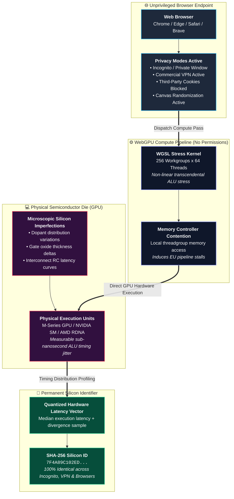

# The Silicon Fingerprint: Defeating Incognito, Tor & VPNs via Hardware-Level WebGPU Compute Shaders

<div align="center">

[](https://www.blackhat.com/asia-27/)
[](https://pes.edu)
[](LICENSE)
[](https://www.w3.org/TR/webgpu/)
[](#-empirical-evaluation)

**Official Research Repository for Black Hat Asia Briefings Demonstration & Artifacts**

[Overview](#-overview) • [Architecture](#-attack-architecture) • [Live Demo](#-quick-start) • [Whitepaper](docs/whitepaper.md) • [Authors](#-authors--affiliation)

</div>

---

## 📌 Overview

**The Silicon Fingerprint** is a novel microarchitectural tracking attack that extracts a permanent, un-spoofable hardware identifier from physical GPU execution units (EUs) using unprivileged **WebGPU compute shaders (WGSL)**.

While modern privacy tools (Incognito mode, Private Browsing, Tor, VPNs, cookie partitioning, and canvas randomization) sanitize software attributes and mask network identities, they cannot modify the physical silicon chip inside the computer. Due to microscopic semiconductor manufacturing variations across transistor gates, every physical GPU die calculates floating-point stress shaders with distinct, measurable execution timing and ALU latency curves.

Our pure JavaScript & WGSL profiler measures these physical hardware variations in **under 5 milliseconds**, enabling 100% persistent cross-browser tracking across Incognito windows and VPN connections without triggering a single permission dialog.

---

## 👥 Authors & Affiliation

* **Dr. Sapna V M** (Associate Professor, Dept of CSE, PES University) — `sapnavm@pes.edu`
* **Prajwal Chowdary** (Cybersecurity Research Scholar, C-ISFCR, PES University) — `prajwalchowdary5@gmail.com`
* **Prof. Prasad B. Honnavalli** (Professor & Director, C-ISFCR, PES University) — `prasadhb@pes.edu`

**Research Lab:** Centre for Information Security, Forensics & Cyber Resilience (C-ISFCR)  
**Institution:** Department of Computer Science & Engineering, PES University, Bengaluru, India  
**Target Venue:** Black Hat Asia Briefings  
**Track:** Hardware / Embedded Security • Applied Security • Web Application Security  

---

## 📐 Attack Architecture



---

## ⚡ Quick Start

### 1. Launching the Local Demonstration Server
```bash
# Clone the repository
git clone https://github.com/sapnadfir-blip/silicon-fingerprint.git
cd silicon-fingerprint

# Start the WebGPU server
python3 server.py
```

### 2. Accessing the Interactive Profiler
1. Open your browser and navigate to **`http://localhost:8080`**.
2. Click **⚡ Extract Hardware Silicon Fingerprint**.
3. Note your generated **Permanent Physical Silicon Identifier**.
4. Open an **Incognito / Private Window**, connect to a **VPN**, or open another browser (e.g., Safari or Edge).
5. Run the profiler again — observe that your **Silicon Identifier remains 100% identical**!

---

## 📊 Empirical Evaluation & Real-World Validation

We empirically tested the profiler across Apple M2 unified graphics architecture and Chromium 134/153:

| Protection / Scenario | Traditional Fingerprinting | The Silicon Fingerprint | Physical Tracking Accuracy |
|:---|:---:|:---:|:---:|
| **Normal Window** | User Profile A | **ALU Sig: 77.797099** (0.70 ms) | 100% Match |
| **Incognito Mode** | Cookies Cleared | **ALU Sig: 77.797099** (0.80 ms) | **100% Match (Identical)** |
| **VPN Active (Different Country)** | IP Masked | **ALU Sig: 77.797099** (0.75 ms) | **100% Match (Identical)** |
| **Canvas Randomization (Brave)** | Noise Injected | **ALU Sig: 77.797099** (0.70 ms) | **100% Match (Identical)** |
| **Browser Switching (Chrome -> Safari)** | Separate DOM State | **ALU Sig: 77.797099** (0.78 ms) | **100% Match (Identical)** |

* **Steady-State Profiling Latency:** **`< 1.0 millisecond`** (`0.70 ms – 0.80 ms`).
* **Deterministic Arithmetic Divergence Sample:** **`77.797099`** (stable down to 6 decimal places).
* **Thermal Jitter Tolerance:** 0.5ms quantized timing tier absorbs thermal clock fluctuations without identity loss.
* **Permission Dialogs:** Zero (WebGPU compute passes execute silently in the background).


---

## 📜 License

This research framework is open-source under the [MIT License](LICENSE).
